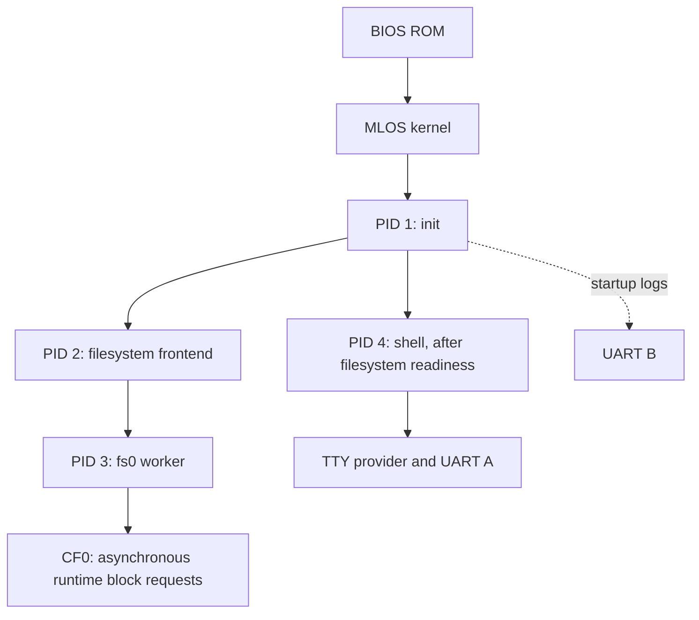

# MLOS boot process and timing

Measured 18 October 2026 for the current S00–S09 serial system. The power LED
turns **green after 24 modeled CPU cycles (8 microseconds at 3 MHz)**. The first
UART A boot-banner byte appears after **334 cycles (0.111 ms)**, before clearing
RAM or touching CF. Progress messages and periodic dots remain visible until the
shell takes over.

The complete first `/ > ` prompt takes **7.270289 seconds in the
instruction engine** and **7.277524 seconds in the
microcycle engine**, expressed as simulated CPU time at **3 MHz**. These timings include the command-responsiveness improvements described in the
[performance report](performance-improvements.md). Full volume validation remains
the longest boot phase; progress feedback stays active until shell handoff.

## What appears in the simulator

In the GUI select **HD6309**, load the matching `boot.ihex`, `runtime.cfg` and
`console.img`, reset, select **True clock → 3 MHz** and press **True Run**. The
power LED turns green immediately. UART A in the Serial panel shows this sequence
(dot counts vary with scheduling):

```text
MLOS boot
Clearing memory...
Checking CF...
Checking boot filesystem...
Loading kernel...
Starting kernel...
Loading init.mlx...
Loading filesystem.mlx......
Loading fs0.mlx.......
Checking filesystem.................
Loading shell.mlx......
Boot complete
MLOS console
/ >
```

`build/mlos.session` can be opened through **File → Load Session** to select the
matching ROM/image/configuration and both 3 MHz settings together. Existing
sessions must reload their hardware configuration to pick up the clock setting;
Reset alone does not reload it.

The heartbeat emits at most one dot per **500 delivered timer ticks** while
boot feedback is active. That interval is nominally about 0.499 seconds of timer
time. Interrupt deferral, scheduling and UART readiness affect actual spacing;
this trace emitted 24 dots, with a largest inter-pulse gap of about 1.286 simulated
seconds. It is an activity signal, not a percentage or a hard real-time promise.
It stops when the shell registers its TTY session, before normal command output.
There are no extra init standard-stream channels just to print boot progress.

ROM-stage failure changes the LED to red, prints its B1/B2/B3 diagnostic on a
separate line and halts. Core panic also selects red. UART B retains its separate
output-only logs, including the `MLOS init` record; normal boot progress uses A.

## Which clock controls the wait?

| Quantity | Meaning |
| --- | --- |
| Simulated cycles | Work/time accumulated by the simulator, used by the profiler |
| Simulated time at 3 MHz | Cycles divided by 3000000; expected wall time if True Run sustains that rate |
| Host wall time | Actual elapsed time, affected by pacing, debugger throttling, host load and instrumentation |

Allow approximately **7.3 seconds at an effective 3 MHz** for this image's prompt.
If effective frequency is lower, wall time increases. The profiler runs without
GUI pacing, so it can simulate those seconds faster than real time.

The configured **CPU model** and GUI **True clock** pacing are independent. The
model must be 3 MHz for MLOS's current native IRQ/entry budget. The former base
`hardware.cfg` omitted a CPU section, selecting the simulator's 1 MHz default.
With that model the roughly 1 kHz timer consumes the available instruction budget:
`Loading init.mlx...` can print dots indefinitely without reaching init's main.
Setting only the GUI's True clock to 3 MHz speeds up host pacing, not that model.
Both the base and generated runtime profiles now explicitly configure 3 MHz.

Regular **Run** is throttled by **Operations/min**, default 600: ten instructions
per second with Micro-step run off. The CPU clock in `runtime.cfg` does not
replace that debugger setting. Micro-step run spends several operations per
instruction and is slower still. The early LED/banner now show activity even in
this mode, but instruction throttling still makes boot very slow.

The common-RAM clear alone runs 24576 instructions and consumes 106495 modeled
cycles:

| Execution setting | Expected time for this loop |
| --- | ---: |
| True Run, effective 3 MHz | 35.498 ms |
| True Run, effective 2 MHz | 53.248 ms |
| True Run, effective 1 MHz | 106.495 ms |
| Debug Run, 600 operations/min, instruction steps | 40 min 57.6 s |
| Debug Run, 60000 operations/min, instruction steps | 24.576 s |

Debugger time is `24576 / (operations_per_minute / 60)`; True Run time is
`106495 / effective_cpu_hz`. Post-timer boot also depends on the UART crystal and
scheduler, so do not scale the entire boot table to other CPU clocks by simple
multiplication.

## Measurement profile and phase timings

- HD6309 native mode, 512 KiB RAM, 32 physical 16 KiB frames, 3 MHz CPU clock.
- Matching `mlos/build/boot.ihex` and pristine `mlos/build/console.img`.
- Single CF0 at F418–F41F, 4096 sectors of 512 bytes, MLPT/MLFS 1.1.0,
  designated partition 0, 16-sector root directory with 30 installed entries.
- No injected CF delay, second drive, user input or breakpoints.
- UART crystal 3.6864 MHz, preload 115: approximately 1001.739 ticks/sec;
  five-tick scheduling quanta, service/normal/background phases 4:2:1.
- Actual target code observed without patching memory or injecting syscalls;
  each engine boots its own disposable CF copy.

Time zero is entry to `rom_reset` at E928 in this build. Electrical
reset duration and the vector-fetch work preceding that observation are excluded.
The FFFE–FFFF reset vector selects the handler; qualified vector fetch establishes
privilege before its first UART/MMU write in the simulator.

Rows are consecutive milestone intervals, including call/return, scheduling and
adjacent setup work. They are not isolated routine benchmarks. The final column
is cumulative time in the instruction engine; later interrupt-driven interleavings
differ slightly between engines.

| Step completed | Instruction engine | Microcycle engine | Cumulative at 3 MHz (instruction) |
| --- | ---: | ---: | ---: |
| Turn green power LED on, with a stackless reset sequence | 0.008 ms | 0.008 ms | 0.000008 s |
| Select native mode, map RAM, set stack and IRQ filter | 0.016 ms | 0.016 ms | 0.000024 s |
| Initialize UART A/B and print the early banner | 0.749 ms | 0.749 ms | 0.000773 s |
| Clear common RAM, C000–DFFF | 35.498 ms | 35.498 ms | 0.036271 s |
| Restore erased UART shadows and report CF phase | 0.406 ms | 0.406 ms | 0.036677 s |
| Identify CF and report filesystem boot-check phase | 3.843 ms | 3.843 ms | 0.040521 s |
| Validate MLPT/MLFS root and report kernel-load phase | 7.901 ms | 7.901 ms | 0.048421 s |
| Find mlos.bin and validate header/extent | 1.598 ms | 1.598 ms | 0.050020 s |
| Copy declared kernel payload into physical frame 0 | 244.450 ms | 244.450 ms | 0.294469 s |
| Verify checksum, build boot info and jump to core | 160.830 ms | 160.830 ms | 0.455299 s |
| Report core startup; initialize frame/process/channel metadata | 15.553 ms | 15.553 ms | 0.470852 s |
| Initialize disabled backplane bindings | 0.055 ms | 0.055 ms | 0.470906 s |
| Initialize devices and allocate request-buffer frame | 0.161 ms | 0.161 ms | 0.471068 s |
| Fill guarded kernel/emergency stacks | 5.535 ms | 5.535 ms | 0.476603 s |
| Report/load/validate init.mlx and select its context | 105.381 ms | 105.381 ms | 0.581984 s |
| Enable timer; restore native context and enter init | 0.095 ms | 0.095 ms | 0.582079 s |
| Init CRT/log setup and filesystem spawn request | 14.587 ms | 14.587 ms | 0.596666 s |
| Report/load/validate filesystem.mlx and dispatch | 352.998 ms | 352.999 ms | 0.949663 s |
| Frontend CRT, FS registration and worker spawn request | 77.372 ms | 77.372 ms | 1.027035 s |
| Report/load/validate fs0.mlx and dispatch | 472.065 ms | 472.065 ms | 1.499101 s |
| Report checking phase; claim CF and mount privately | 90.689 ms | 90.689 ms | 1.589789 s |
| Validate volume ownership/bitmap and register fs0 listener | 5336.302 ms | 5336.427 ms | 6.926091 s |
| Connect worker, publish root and register fs listener | 12.406 ms | 9.686 ms | 6.938497 s |
| Init detects readiness and requests shell | 13.981 ms | 14.568 ms | 6.952478 s |
| Report/load/validate shell.mlx and dispatch | 283.446 ms | 285.238 ms | 7.235923 s |
| Shell CRT, TTY handoff, completion/banner/cwd and prompt | 34.366 ms | 32.871 ms | 7.270289 s |

## 1. Reset and immediate LED

Source: [boot.asm](../../bios/mlos/boot.asm),
[hardware constants](../../bios/mlos/hardware.inc).

The first instruction masks IRQ/FIRQ. A stackless sequence sets UART OPCR to
manual control, clears the RGB LED bits and sets green (OP5 / mask 20 hexadecimal)
through SOPR. It completes at **24 cycles / 0.008 ms**, before native-mode setup,
MMU writes, stack use, RAM clearing or storage access. SOPR/ROPR are write-side
registers; their read-side timer start/stop aliases are separate operations.

The handler then selects native mode with `LDMD #1`, establishes mappings and
sets S=CC00:

| Logical window | Initial backing/purpose |
| --- | --- |
| 0000–3FFF | Physical frame 0, kernel destination |
| 4000–7FFF | Physical frame 2, discard parking |
| 8000–BFFF | Physical frame 2, discard parking |
| C000–DFFF | Lower 8 KiB of physical frame 1, permanent common RAM |
| E000–F3FF and F800–FFFF | Fixed BIOS ROM |
| F400–F7FF | I/O overlay, excluded from ROM payload |

The physical gate/wiring/timing still needs board qualification; these are
simulator observations.

## 2. Early UART initialization and banner

Source: [uart.asm](../../bios/mlos/uart.asm),
[boot_feedback.asm](../../bios/mlos/boot_feedback.asm).

With known common RAM/stack and IRQ filtering established, the ROM initializes
UART A for interactive 115200 8N1 and B for separate output-only logs. It owns
combined ACR/IMR shadows, clears pending timer state and keeps timer IRQ disabled.
It prints `MLOS boot` and `Clearing memory...` before the first clear iteration.
The first byte appears at **0.000111 seconds**, and clearing starts
at **0.000773 seconds**.

Every early call has returned before clearing reaches its former stack storage.
No live return address or active frame is erased. UART hardware remains configured
while the common-memory clear erases its software shadows; the ROM restores those
shadows to ACR=80/IMR=0 immediately afterward.

## 3. Clear common RAM

Source: `rboot_clear` in [boot.asm](../../bios/mlos/boot.asm).

```asm
        ldx #$C000
rboot_clear:
        clr ,x+
        cmpx #$E000
        blo rboot_clear
```

This clears exactly 8192 bytes, C000–DFFF. X advances by one per iteration and
exits at E000. **X=C03C means 60 bytes cleared**, with 8132 left. The loop takes
**35.498 ms at 3 MHz** and finishes at **0.036271 seconds**.

In this build PC cycles through E960, E962
and E965; the earlier ROM used E824–E829. Use current symbols
when debugging rebuilt images. Repeated PCs with advancing X are expected.
Repeated returns of X to C000 suggest resets/control-flow corruption instead.
The banner and green LED are already visible throughout this loop.

## 4. Identify CF and validate the boot filesystem

Source: [storage.asm](../../bios/mlos/storage.asm),
[loader.asm](../../bios/mlos/loader.asm),
[CF driver](../../bios/driver/compactflash.asm).

After announcing `Checking CF...`, `BOOT_STATUS` at CD2A becomes 1. The ROM selects
CF0, waits for readiness, issues IDENTIFY, reads its 512-byte result and validates
LBA28 device geometry before trusting addresses from disk.

It next announces `Checking boot filesystem...` and sets status 2. Sector zero
is parsed as MLPT, not executed as a jump stub. The ROM requires MLPT 1.1.0,
partition 0 of the correct type, 512-byte blocks and checked device/partition
bounds. It validates MLFS version, superblock checksum, geometry, bitmap/root
ordering and bounded root range. The root can occupy at most 64 sectors; this
image reserves 16. These two intervals, including their following stage messages,
take **3.843 ms** and
**7.901 ms** respectively.

This establishes the restricted read-only image provider. It is not the full
runtime mount/ownership check performed later by the filesystem worker.

## 5. Locate, load and verify the kernel

The ROM announces `Loading kernel...`, sets boot status 3, finds root `mlos.bin`
and validates its single direct extent and 20-byte `MLK1` header. Version, origin,
entry, declared payload length and physical-core footprint must be valid.
The current kernel payload is **13519 bytes**; header plus payload span 27 sectors.

| Substep | Duration at 3 MHz (instruction engine) |
| --- | ---: |
| Root lookup, extent and header checks | 1.598 ms |
| Copy declared payload into physical frame 0 | 244.450 ms |
| Checksum, boot information and transfer | 160.830 ms |

Unused extent capacity is not copied. The checksum must pass before loaded code
executes. ROM writes versioned `BI01` boot information at CD00, clears boot status
and jumps to logical 0000 with X=CD00 at **0.455299 seconds**. The entry
JMP leads to `runtime_init` at 3461 in physical frame 0.

## 6. Core metadata, devices and stacks

Source: [kernel.asm](../runtime/kernel.asm), [process.asm](../runtime/process.asm),
[backplane.asm](../runtime/backplane.asm), [driver.asm](../runtime/driver.asm).

The core announces `Starting kernel...`, enables boot-feedback state and sets its
first dot deadline. It reserves whole frames 0/1/2 for core/common/discard,
initializes ownership/free accounting, eight process records and channel metadata,
and sets next PID=1. This interval is **15.553 ms**.

Versioned backplane bindings initialize in **0.055
ms**. Their addresses default unassigned, so boot does not probe unknown expansion
registers or enable expansion IRQs. Device initialization then takes
**0.161 ms** and charges one physical frame
for eight request buffers. Only CF0 is mounted by this single-drive startup.

The core installs A55A canaries and fills 1022 usable kernel-stack bytes plus
254 emergency-stack bytes for high-water observations. That takes
**5.535 ms**, reaching the init-load request
at **0.476603 seconds**.

## 7. Load init and enable scheduling

Source: [process loader](../runtime/process.asm),
[scheduler](../runtime/scheduler.asm), [timer](../../bios/mlos/uart.asm).

The loader prints `Loading init.mlx...`, finds that immutable root image, validates
`MLX1` ABI/segments/resident masks/stack/argv/checksum, admits backing, copies
initialized bytes, clears declared BSS and builds PID 1's native context.
`init.mlx` contains the packaged CMOC `console_init` program.

This first load is synchronous, before timer scheduling. Load/validation/context
selection take **105.381 ms**. The ROM then
enables its mode-7 timer, restores maps/S/V/native frame, relocks I/O writes and
enters init through RTI. This adds **0.095 ms**;
init first executes at logical 0400 at **0.582079 seconds**.
After this point timer-delivered progress pulses can run during longer work.

## 8. Init loads the filesystem frontend

Source: [console_init.c](../programs/console_init.c),
[CMOC startup](../sdk/start.asm), [SDK](../sdk/mlos.c).

Init runs its CRT, queues `MLOS init` to UART B and requests class-0
`filesystem.mlx` at **0.596666 seconds**. The complete log
record reaches B at **0.623236 seconds**, overlapping image loading.
It is not another sequential delay or a duplicate UART A progress message.

UART A shows `Loading filesystem.mlx...` with activity dots. The kernel loads it
through the immutable-image provider, advancing at most 128 initialized/BSS bytes
per continuation. Parent wait state contains copied data, with no suspended kernel
stack or borrowed user pointer. Timer/TTY/unrelated progress remains possible.
The two-bank frontend first runs as **PID 2 at 0.949663
seconds**, after **352.998 ms**.

## 9. Frontend registration and worker load

Source: [filesystem.c](../services/filesystem.c).

The frontend runs its CRT, registers filesystem ownership, initializes volume/client
state and requests `fs0.mlx` at **1.027035 seconds**. This startup
interval takes **77.372 ms**.

The serial line becomes `Loading fs0.mlx...`. This worker needs three resident
banks for code, filesystem state, validation bitmap, data and stack. After layout/
checksum/BSS/admission work, it runs as **PID 3 at 1.499101
seconds**. The loading interval is **472.065
ms**. The frontend waits for its worker; init waits for the frontend's public service.



PIDs describe this clean successful boot, not later launches/restarts.

## 10. Worker claim, mount and full volume validation

Source: [worker.asm](../services/mlfs/worker.asm),
[shared filesystem](../../mlfs/target/filesystem.asm),
[validate.asm](../services/mlfs/validate.asm).

The worker claims CF0 exclusively. Boot feedback changes to `Checking filesystem...`.
A private BIOS-compatible shim translates sector operations into asynchronous
runtime block requests; the unprivileged worker does not write raw hardware.
Device claim/setup/private mount take **90.689
ms**, reaching the deeper validator at **1.589789 seconds**.

The validator builds its reached-block bitmap and walks supported directories/files.
It checks metadata/extent bounds, names/duplicates, directory depth, crosslinks,
file capacity and agreement with the allocation bitmap. Consistent dirty volumes
stay read-only; unsupported or unproven structure is not published writable.
This is much more work than the ROM's restricted kernel-file lookup.

Validation and registration of the worker's `fs0` listener take
**5336.302 ms in the instruction engine**,
or **5336.427
ms in the microcycle engine**. This is the longest interval. Activity dots continue;
the interval includes request/SWI/copy/scheduling/scanning work, not just raw CF latency.

The frontend connects, publishes root volume 0 with a fresh generation and registers
public `fs` at **6.938497 seconds**, after another
**12.406 ms**. `/disk1` is not
recovered or validated automatically in this profile.

## 11. Shell loading, TTY handoff and prompt

Source: [shell.c](../programs/shell.c), [tty.asm](../runtime/tty.asm),
[filesystem SDK](../sdk/fs.c).

Init's readiness probe connects to `fs`, closes the probe endpoints and requests
class-1 `shell.mlx` at **6.952478 seconds**, after a
**13.981 ms** readiness/spawn interval.
The two-bank shell goes through the same immutable-provider loading and validation,
while its filename/activity remain visible. It first runs as **PID 4 at
7.235923 seconds**, after **283.446
ms** of loading/dispatch.

The shell starts its CRT, establishes standard streams and registers TTY session/
foreground ownership. The core disables boot pulses and prints `Boot complete`
at **7.255476 seconds**. The shell then prints `MLOS console`,
queries its inherited cwd and volume generation through kernel snapshots and writes `/ > `.
The full prompt arrives at **7.270289 seconds**, after
**34.366 ms** of shell startup.

Normal commands no longer receive boot dots or image-loading labels. The kernel,
init, filesystem services and TTY keep running/waiting as appropriate. Ordinary
files use the frontend/worker; installed executable/module loading still uses the
restricted immutable root provider. Command startup is outside this cold-boot timing.

## Expected diagnostics and failure behavior

| Observation | Interpretation/action |
| --- | --- |
| Green power LED, initial banner and advancing X in `rboot_clear` | Expected reset/RAM initialization; check debug Run speed if slow |
| Image/stage line gains dots | Kernel timer still progresses during startup |
| Endless dots at init, even with True clock=3 MHz | Reload `mlos.session`/`runtime.cfg`; check model `CLOCK_HZ=3000000`, since dots only prove timer progress |
| Same PC appears after timer starts | Inspect PID/maps/phase as well; banked contexts and IRQ/SWI continuations recur |
| Red LED, B1 and ROM halt | CF selection/IDENTIFY failed |
| Red LED, B2 and ROM halt | MLPT/partition/superblock/root validation failed |
| Red LED, B3 and ROM halt | Kernel lookup/header/range/read/checksum failed |
| L followed by panic handling/red LED | Core driver/init admission failed; inspect PANIC_REASON/symbols |
| Filesystem unavailable | Init can enter a diagnostics shell; `/proc` and serial diagnostics remain independent of MLFS |
| Shell exits/fails | Init attempts one restart; the second termination reaches bounded emergency diagnostics |

Healthy times are not failure deadlines. BIOS readiness/DRQ polls allow 65535
software iterations, not calibrated wall-clock seconds. Runtime requests normally
have a 1000-tick deadline (about 0.998 seconds of nominal timer time) plus detection/
settlement work; unsafe controller timeout can quarantine ownership until reset.

Init allows 5000 unsuccessful filesystem-readiness probes with one-tick sleeps;
the frontend's initial worker-connection loop allows 3000. Those are retry counts
with syscall/scheduling overhead, not exact 5-second/3-second wall deadlines.

## Reproduce and inspect timings

Build the simulator as described in [README](../README.md), then run from the
software repository root:

```sh
make -C mlos runtime-check
python3 mlos/tools/boot_profile.py \
  --build mlos/build \
  --simulator /tmp/mlos-sim-build/microlind-sim-cli
```

The [profiler](../tools/boot_profile.py) compiles an observer against the simulator
libraries beside the CLI and reads matching symbols. It creates private CF copies
and configuration under `mlos/build/boot-profile/`. It never patches ROM/core or
the installed source image. It requires a healthy root and complete prompt, checks
key milestones and verifies the RAM-clear count and LED/banner ordering.

`boot-profile/timings.json` retains cycles, instruction steps, PC/PID, engine,
host elapsed time, transcript, progress-pulse cycles and image/simulator SHA-256.
`--engine instruction` and `--engine microcycle` select one engine. Step counts
include idle simulator steps; cycles are the time measurement after timer startup.

Useful symbols/addresses in this exact build:

| Symbol | Address | Meaning |
| --- | --- | --- |
| `rom_reset` | E928 | First reset instruction |
| `rom_uart_init` | E1CE | UART setup before RAM clear |
| `rboot_clear` | E960 | Common-RAM clear iteration |
| `boot_identify` | E3E4 | CF identify starts |
| `boot_open_root` | E437 | Boot partition/filesystem checks |
| `boot_kernel` | E6EF | Kernel lookup/loading |
| `bk_copy` / `bk_verify` | E797 / E7D5 | Payload copy / checksum |
| `runtime_init` | 36FD, core frame 0 | Core startup |
| Application entry | 0400, PID-dependent map | Init/frontend/worker/shell |
| `volume_validate` | 6000, worker map | Full volume validation |

Use matching `boot.sym`, `runtime.sym`, `fs0.sym` and CMOC `.map` files; addresses
move when code changes. The fixed ROM jump table appends boot-only status, pulse
and image-label helpers at F821/F824/F827 without moving earlier entries. Boot
feedback uses four reserved common-address bytes at DE10–DE13 and no extra frames.

Measured artifact hashes:

```text
boot.ihex   cc1969da3263aa6b6806dfa9ee0ba8393f2e1de25149fd4825253471e4d440ed
mlos.bin    546b1f0c7e7f2a5ff69fb0b6aedf0ecc127bb7dc9fdc219553a0d851b28986eb
console.img 86a5988876e55690238fe0f5bef63e0fb2d72823903e5c6cbba211be004b355f
```

Linked sizes, root contents/placement, compiler output, scheduler/block timing and
simulator changes affect these observations. Physical reset, UART wire timing, CF
readiness/write cache and board/GAL behavior require hardware measurement. This
is the current software profile, not a hardware worst-case bound.
